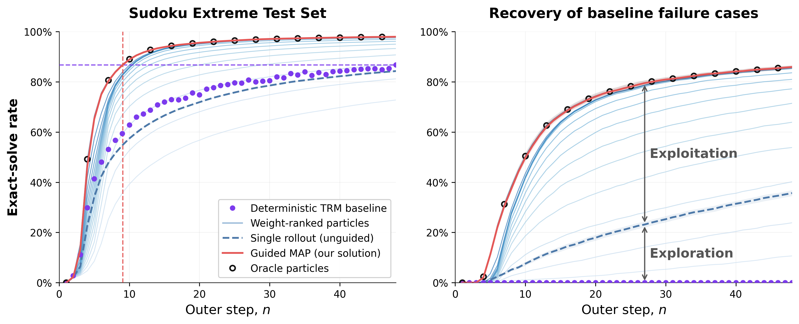

# BIGR: Boosting Inference with Guided Reasoning

**Tiny recursive models, think BIGR.** Code, cached results and reproduction recipes for the
NeurIPS 2026 paper
[_Boosting Inference with Guided Reasoning: Stochastic Exploration for Recursive Models_](https://openreview.net/forum?id=nZD0FHMUmR)
(Corbett, Tzatzopoulou, Sood, Ramesh, Dodwell; digiLab and the University of Bristol).

[](https://github.com/digiLab-ai/bigr/actions/workflows/ci.yml)
[](LICENSE)

[](https://arxiv.org/abs/2605.25230)



A tiny recursive model (TRM, 7M parameters) reasons by iterating a latent dynamical
system. BIGR treats that iteration as approximate inference: stochastic perturbations of
the recursion propose neighbouring trajectories, and the model's own early-stopping head
reweights them online, a guided particle filter over the frozen backbone. Deterministic
recursion is the one-particle, zero-noise limit. Three diagnostics computed from the
inference traces (local stability, guide alignment, cloud-token entropy) predict when the
procedure helps and which outputs to trust.

Nothing is retrained. On Sudoku-Extreme the exact-solve rate rises from 85.9% to 98.0%; on
PPBench, with a backbone trained for it and no tuning, from 62.5% to 77.9%; on Maze-Hard
the diagnostics flag a misaligned guide, and the gain does not materialise.

## Results at a glance

Terminal exact-solve rate (%), mean ± one standard deviation over 5 seeds x 5 folds unless
stated. Every number is a row of
[`assets/runs/analysis/register/metrics.csv`](assets/runs/analysis/register/metrics.csv),
rebuilt by `bash scripts/build_tables.sh`; the full table, with the particle-cloud
statistics and the corrupted-guide column, opens
[`assets/runs/analysis/register/REPORT.md`](assets/runs/analysis/register/REPORT.md).

| Method                               | Sudoku-Extreme Test | Sudoku-Extreme DF | Maze-Hard Test | PPBench val    |
| ------------------------------------ | ------------------- | ----------------- | -------------- | -------------- |
| Deterministic TRM (frozen backbone)  | 85.9 ± 0.6          | 0.0               | 86.6 ± 2.1     | 62.5           |
| Single stochastic rollout (beta = 0) | 84.3 ± 0.7          | 35.7 ± 2.8        | 85.2 ± 2.5     | 63.6 ± 1.6     |
| **BIGR: sequential guiding (ours)**  | **98.0 ± 0.2**      | **85.9 ± 1.5**    | 85.6 ± 2.8     | **77.9 ± 0.6** |
| Oracle (any particle correct)        | 98.1 ± 0.5          | 88.4 ± 0.6        | 91.3 ± 2.7     | 82.8 ± 0.7     |

DF is the _deterministic-failure_ split: the test puzzles the frozen backbone cannot solve
on its own. The core runs evaluate whole batches: Sudoku-Extreme Test 9,984 of 10,020 and
DF 1,408 of 1,427 puzzles, Maze-Hard Test 992 of 1,000, PPBench validation 253 (paper
Table 2).

## Install

Python 3.12. CPU is enough for the next section; the experiments ran on one NVIDIA H100
(80 GB), and Apple-silicon GPUs handle small runs (`--device mps`).

```bash
python3.12 -m venv .venv && source .venv/bin/activate
pip install -r requirements.txt      # exact versions used for the paper
pip install -e .                     # the `bigr` and `trm` packages from src/
```

For CUDA, install the matching PyTorch wheel first (for example
`pip install torch==2.11.0 --index-url https://download.pytorch.org/whl/cu126`).
Training the backbones additionally needs `pip install -e ".[train]"`.

## Verify without a GPU (about one minute)

```bash
bash scripts/smoke_test.sh            # imports, cached runs, Figures 1 and 2 -> tmp/smoke_figures/  (~10 s)
bash scripts/regenerate_figures.sh    # Figures 1-8 -> assets/figures/                                (~30 s)
bash scripts/build_tables.sh          # evidence register -> assets/runs/analysis/register/          (seconds)
pytest                                # tiny in-memory backbone, figure renders, register rebuild    (~15 s)
```

Everything here runs from the cached summaries under `assets/runs` (about 60 MB); no
checkpoint or dataset is needed. The tests include the deterministic limit (S = 1,
sigma = 0 equals the TRM) and check that the register rebuilds to the committed values.

## Data and checkpoints

Nothing under `data/` is committed except the PPBench splits. The scripts expect this
layout (`--checkpoint` and `--data-dir` override it):

```
data/
  sudoku_extreme/checkpoints/last.ckpt
  sudoku_extreme/dataset/sudoku_extreme/{train,val,test,impossible}/
  maze_hard/checkpoints/last.ckpt
  maze_hard/dataset/maze-30x30-hard-1k/{train,val,test,impossible}/
  ppbench/{train,val,test}/            # committed: 33,460 / 253 / 42 puzzles, four types
  ppbench/checkpoints/last.ckpt
```

**Download.** The three frozen backbones (74, 104 and 106 MB) and the intermediate
Sudoku-Extreme checkpoints are on the Hugging Face Hub as `andrw3000/bigr-checkpoints`, in
a layout that mirrors `data/`; the raw particle traces are the dataset repo
`andrw3000/bigr-traces`.

```bash
python scripts/download_checkpoints.py                     # the three checkpoints
python scripts/download_checkpoints.py --all-checkpoints   # plus the intermediate checkpoints for Figure 8 (~1.5 GB)
python scripts/download_checkpoints.py --traces            # the raw particle traces (3.9 GB)
```

**Evaluation splits.** The paper evaluates Sudoku-Extreme Test 10,020 and DF 1,427 puzzles
and Maze-Hard Test 1,000 and DF 134 mazes (`impossible/` on disk). They are not
redistributed; `python scripts/data/build_eval_cohorts.py` rebuilds them in the paper's row
order from the HRM releases, using the index files in `assets/cohorts/` (its README explains
them). `bash scripts/data/build_df_split.sh sudoku_extreme` re-derives a DF split on your own
hardware; it reproduces the paper's only at the paper's precision (see _Provenance_), so
evaluate the paper's cohorts from the rebuilt splits.

**Datasets for training.** Sudoku-Extreme and Maze-Hard are the HRM releases on the Hub
(`sapientinc/sudoku-extreme`, `sapientinc/maze-30x30-hard-1k`). The builders package them
in the TRM on-disk format with the settings the backbones were trained with (1,000
Sudoku-Extreme puzzles with 1,000 shuffling augmentations; Maze-Hard unaugmented):

```bash
python scripts/data/build_sudoku_extreme_dataset.py --output-dir data/sudoku_extreme/dataset/sudoku_extreme \
       --subsample-size 1000 --num-aug 1000 --eval-ratio 0.01
python scripts/data/build_maze_dataset.py --output-dir data/maze_hard/dataset/maze-30x30-hard-1k --num-aug 0 --eval-ratio 1.0
ln -s val data/maze_hard/dataset/maze-30x30-hard-1k/test   # Maze-Hard's released evaluation set serves as both
```

The Sudoku-Extreme builder's held-out subsample (4,227 puzzles) is not the paper's Test
split. PPBench (Pencil Puzzle Bench) is four puzzle types merged into one task;
`data/ppbench/README.md` records how the committed splits were derived from the public
release (MIT).

**Training the backbones (optional).** One H100 each, with the vendored nano-trm code and
its default hyperparameters (about 2 h for Sudoku-Extreme, 14 h for Maze-Hard;
`logger=csv` trains without Weights & Biases):

```bash
python -m trm.nn.train experiment=trm_sudoku_extreme_1k_aug_1k data.data_dir=data/sudoku_extreme/dataset/sudoku_extreme
python -m trm.nn.train experiment=trm_maze                     data.data_dir=data/maze_hard/dataset/maze-30x30-hard-1k
python -m trm.nn.train experiment=trm_ppbench                  data.data_dir=data/ppbench
```

The Q-head (halting head) that BIGR uses as its guide is part of every checkpoint; nothing
is trained for inference. Configs: `src/trm/nn/configs/experiment/`.

## Reproduce the paper

One driver generates every run artefact, one script renders the figures, one builds the
tables. With the checkpoints and datasets in place:

```bash
bash scripts/reproduce_all.sh                                   # everything: ~30 GPU-hours on one H100, plus traces and PPBench
bash scripts/run_experiments.sh --profile sudoku_extreme --main-result   # one item at a time
bash scripts/run_experiments.sh --help                          # every flag, named after the paper item it feeds
bash scripts/run_experiments.sh --profile sudoku_extreme --smoke --main-result --device mps   # tiny sanity run, writes to tmp/
```

| Paper item                                    | Driver flag(s)                                           | Cached output                                                             | Renderer / table source                                             |
| --------------------------------------------- | -------------------------------------------------------- | ------------------------------------------------------------------------- | ------------------------------------------------------------------- |
| Table 1, Figure 1 (Sudoku-Extreme)            | `--profile sudoku_extreme --main-result --df-recovery`   | `assets/runs/sudoku/pf_seed_fold_*`                                       | `fig_pf_main.py`; `paired_stats`                                    |
| Table 1 (Maze-Hard), Table 12                 | `--profile maze_hard --main-result --df-recovery`        | `assets/runs/maze/pf_seed_fold_*`                                         | `paired_stats`                                                      |
| Table 1 PPBench column, Tables 9, 10, 14      | `--ppbench`                                              | `assets/runs/analysis/ablations/ppbench/`                                 | `eval_ppbench.py`, `eval_ppbench_suite.py`, `run_trace_analyses.py` |
| Table 1 particle-cloud rows, Tables 8, 10, 14 | `--traces` (both profiles)                               | `assets/runs/analysis/ablations/calibration_corruption/`                  | `run_trace_analyses.py`                                             |
| Table 2 puzzle counts, Table 7 paired rules   | `--main-result-quick --df-recovery-quick` + `--analysis` | `assets/runs/*/pf*_k5`, `analysis/paired_stats`                           | `run_paired_stats.py`                                               |
| Table 3 cost vs S                             | `--timing`                                               | `analysis/ablations/timing/`                                              | `bench_device.py`, `build_timing_table.py`                          |
| Table 5 inner depth                           | `--inner-depth`                                          | `analysis/ablations/inner_depth/`                                         | register                                                            |
| Table 6 noise families                        | `--noise-families` (both profiles)                       | `analysis/ablations/noise_families/`                                      | register                                                            |
| Table 11 deterministic depth                  | `--depth-baseline`, `--ppbench-depth`                    | `analysis/ablations/baselines/e2_depth_sudoku`, `analysis/ppbench_depth/` | register                                                            |
| Table 13 particle-count frontier              | `--frontier`                                             | `analysis/ablations/baselines/e1c_frontier_sudoku`                        | register                                                            |
| Figure 2                                      | `--inner-deviation --sigma-guided`                       | `sudoku/inner_deviation_k5`, `sudoku/sigma_guided_results_k5`             | `fig_inner_deviation.py`                                            |
| Figure 3                                      | `--guide-alignment` (both profiles)                      | `*/continuation_labels_*`                                                 | `fig_guide_alignment.py`                                            |
| Figures 4, 7                                  | `--token-entropy`                                        | `sudoku/entropy_{test,impossible}_k5`                                     | `fig_token_entropy.py`, `fig_token_contraction.py`                  |
| Figure 5                                      | `--profile maze_hard --inner-deviation`                  | `maze/inner_deviation_maze_hard_k5`, `sudoku/q_training`                  | `fig_maze_case_study.py`                                            |
| Figure 6                                      | `--ablation-sensitivity` (both profiles)                 | `*/ablation_sensitivity_*`                                                | `fig_ablation_sensitivity.py`                                       |
| Figure 8                                      | `--checkpoint-sweep` (needs `--all-checkpoints`)         | `sudoku/pf_checkpoint_sweep`                                              | `fig_checkpoint.py`                                                 |

`assets/runs/README.md` lists every cached directory with the protocol that produced it
(`assets/experiments_log.json` has the same in JSON). `--analysis` (paired statistics,
calibration ladder, early stopping, register) runs in seconds on CPU once the run
directories exist.

Wall-clock on one H100 at the paper settings: Sudoku-Extreme seed-fold runs 6 h (Test) and
1 h (DF); Maze-Hard Test 2 h; inner deviation 30 min per benchmark; continuation labels
1 h; sigma sweep 2 h; sensitivity sweeps 3 h per benchmark; token entropy 1.5 h; checkpoint
sweep 6 h. Peak memory at batch 64 and S = 16 is near 80 GB; reduce `--batch-size` on
smaller GPUs.

## Hyperparameters

Paper Table 4. Common to Sudoku-Extreme and Maze-Hard: S = 16 particles, N = 48 outer
steps, tau_ESS = 0.3 (resample when ESS < tau_ESS S, systematic resampling), 5 folds with
fold seed 31. The inner depth M is the checkpoint's trained value, not a free parameter.

| Benchmark      | sigma | beta | M   | Seeds               | Design                                        |
| -------------- | ----- | ---- | --- | ------------------- | --------------------------------------------- |
| Sudoku-Extreme | 0.3   | 0.25 | 6   | 31, 32, 33, 34, 35  | 5 seeds x 5 folds, ± seed-fold s.d.           |
| Maze-Hard      | 0.5   | 1.0  | 4   | 31, 41, 59, 83, 109 | 5 seeds x 5 folds, ± seed-fold s.d.           |
| PPBench        | 0.3   | 0.25 | 4   | 31-35               | 5 seeds, one fold, tau_ESS = 0.5, ± seed s.d. |

`scripts/exps/run_pf.py --profile <name>` applies these defaults; every flag can be
overridden (`--sigma`, `--beta`, `--ess-threshold`, `--particles`, `--total-steps`,
`--noise-family {gaussian,laplace,student_t}`, `--inner-depth`). Error bars throughout
are one sample standard deviation over the stated cells; no normality is assumed.

## Repository layout

```
src/bigr/                guided particle filter: backbone adapters, stochastic kernel, resampling, filter, plot helpers
src/trm/                 the TRM backbone (trimmed fork of nano-trm, MIT; see NOTICES.md) with its Hydra training entry point
scripts/run_experiments.sh    every experiment in the paper, one flag each
scripts/regenerate_figures.sh Figures 1-8 from the cached runs
scripts/build_tables.sh       the evidence register (every table) from the cached runs
scripts/smoke_test.sh         no-GPU sanity check;  scripts/reproduce_all.sh  the whole pipeline
scripts/exps/            run_pf.py (the inference runner) and the per-figure experiment runners
scripts/figs/            one renderer per figure
scripts/analysis/        offline analyses over saved runs: paired statistics, trace analyses, PPBench evaluation, register
scripts/data/            dataset and cohort builders, DF-split builder, training-log collector;  scripts/download_checkpoints.py
assets/runs/             cached run summaries (about 60 MB) and the register;  assets/figures/  the paper's figures
assets/cohorts/          index files identifying the evaluation cohorts;  data/ppbench/  the PPBench splits
tests/                   CPU tests on a tiny in-memory backbone, figure smoke renders, register rebuild
```

The method itself is small: `bigr.filter.BIGRFilter` runs the outer loop (propose with
`bigr.stochastic.StochasticFTheta`, tilt by the Q-head, resample on ESS; the terminal
answer is the highest-weight particle) over the adapters in `bigr.backbone`, which expose a
TRM checkpoint's embedder, recursion, decoder and Q-head.

```python
from bigr import (BIGRFilter, InferenceConfig, StochasticFTheta, TRMCoreDecoder, TRMCoreQHead,
                  TRMNativeCycleFTheta, load_trm_backbone_checkpoint)

trm = load_trm_backbone_checkpoint("data/sudoku_extreme/checkpoints/last.ckpt", map_location="cpu", use_ema=True).eval()
f = StochasticFTheta(TRMNativeCycleFTheta(trm), sigma=0.3)
pf = BIGRFilter(f, TRMCoreQHead(trm), TRMCoreDecoder(trm),
                InferenceConfig(particles=16, total_steps=48, beta=0.25, ess_threshold=0.3),
                h_cycles=int(trm.hparams.H_cycles))
```

`scripts/exps/run_pf.py` shows the full loading, batching and output conventions.

## Provenance

- **Committed:** all code used for the paper; every run summary behind every table and
  figure; the evidence register; the PPBench splits; the cohort index files; the training
  configs; the figures.
- **Hosted on the Hub:** the checkpoints, the intermediate checkpoints and the raw particle
  traces (3.7 GB). The CSVs derived from the traces are committed, so every table rebuilds
  without them.
- **From training logs:** `sudoku/q_training` and `pf_checkpoint_sweep/training_progress.csv`
  are Lightning logs written by `scripts/data/collect_training_logs.py`; Table 3
  (`h100_timing.md`) is the output of `--timing` on the paper's H100.
- **Hardware sensitivity:** the DF splits and the Table 11 depth profiles are defined by the
  paper's bfloat16 runs on an H100; the deterministic predictions recorded in the traces
  score 0 of 1,427 and 0 of 134 on the two DF splits. In float32, as the model runs on Apple
  and CPU backends, about 40% of the Sudoku-Extreme DF puzzles solve deterministically and
  the PPBench depth profiles move by one to three puzzles; the Maze-Hard DF split stays at 0%.
- **Needs regenerated arrays:** `run_early_stopping.py` reads the per-step Q-logit arrays of
  the single-seed runs, which `--main-result-quick` regenerates; its output is committed.
- **Figure 1 in the camera-ready PDF** was rendered from the single-seed 5-fold runs
  (`regenerate_figures.sh --quick`); the default here renders the 5 seeds x 5 folds protocol
  of Table 1. The two agree to within 0.1 points; the legend uses Table 1's name for the
  beta = 0 arm, "single rollout".

## Citation

```bibtex
@inproceedings{corbett2026bigr,
  title     = {Boosting Inference with Guided Reasoning: Stochastic Exploration for Recursive Models},
  author    = {Corbett, Andrew and Tzatzopoulou, Anna and Sood, Archit and Ramesh, Sai-Aakash and Dodwell, Tim},
  booktitle = {Advances in Neural Information Processing Systems (NeurIPS)},
  year      = {2026},
  url       = {https://openreview.net/forum?id=nZD0FHMUmR}
}
```

Paper: <https://openreview.net/forum?id=nZD0FHMUmR> (OpenReview), <https://arxiv.org/abs/2605.25230> (arXiv).
Correspondence: andy.corbett@digilab.ai.

## Licence and acknowledgements

Code in this repository is released under the Apache License 2.0 (`LICENSE`); keep the
`NOTICE` file with any redistribution, and please cite the paper if you use the code in
research. The checkpoints and traces on the Hugging Face Hub are released under CC BY 4.0. `src/trm/` is a trimmed fork of [nano-trm](https://github.com/olivkoch/nano-trm) (MIT), which
reimplements the Tiny Recursive Model of Jolicoeur-Martineau (2025) and descends from the
Hierarchical Reasoning Model code of Wang et al. (2025); the Sudoku-Extreme and Maze-Hard
datasets are the HRM authors' releases; PPBench is by Waugh et al. (2026, MIT). Full
attributions and the list of modifications are in `NOTICES.md`.
